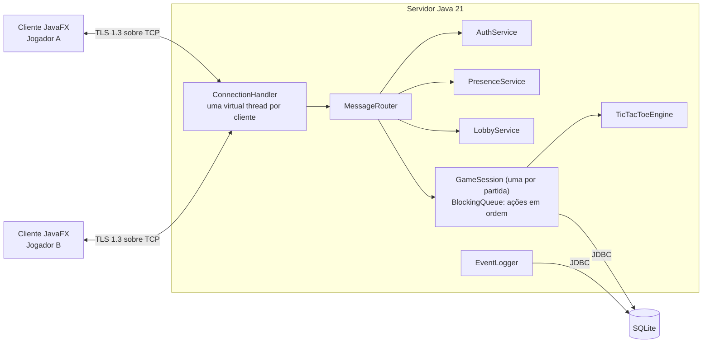

# Jogo da Velha em Rede

Jogo da Velha online para 2 jogadores, feito para o Capstone de Redes. O servidor Java 21 aceita conexões TCP com TLS 1.3, troca mensagens JSON enquadradas e guarda usuários, partidas e eventos em SQLite. O servidor é a única fonte da verdade: o cliente só envia intenções ("marcar a casa 4") e recebe o estado validado.

> Print/GIF de uma partida: adicionar em `docs/evidencias/` e referenciar aqui.

## Requisitos

- Java 21 (JDK, com `keytool`)
- Nada mais: o Maven vem pelo wrapper (`./mvnw`)
- Testado no macOS 26 (Apple Silicon); o CI roda no Ubuntu

## Como rodar

### 1. Compilar

```bash
./mvnw package -DskipTests
```

Gera `server/target/velha-server.jar` e `client/target/velha-client.jar`.

### 2. Gerar os certificados (uma vez)

```bash
scripts/gerar-certificados.sh                 # servidor e clientes na mesma máquina
scripts/gerar-certificados.sh 192.168.0.10    # acrescenta o IP do servidor na rede
```

Isso cria `certs/server-keystore.p12` (fica no servidor) e `certs/client-truststore.p12` (copie para cada máquina cliente, no mesmo caminho). As senhas vêm de `VELHA_KEYSTORE_PASSWORD` e `VELHA_TRUSTSTORE_PASSWORD` (padrão `changeit`). A pasta `certs/` está no `.gitignore`.

### 3. Subir o servidor (porta 5555)

```bash
java -jar server/target/velha-server.jar
# opções: --port 5555 --db velha.db --keystore certs/server-keystore.p12 --sem-tls
```

### 4. Abrir dois clientes

```bash
java -jar client/target/velha-client.jar                         # cliente gráfico (JavaFX)
java -jar client/target/velha-client.jar --host 192.168.0.10     # servidor em outra máquina
```

Na tela de login: **Cadastrar**, depois **Entrar**. No lobby, escolha um jogador online e clique em **Convidar**.

O jar do cliente leva o JavaFX do sistema em que foi gerado; para outro sistema operacional, rode `./mvnw package` nele.

Há também um cliente de console, útil para depurar o protocolo:

```bash
java -cp client/target/velha-client.jar br.unisinos.velha.client.console.ConsoleClient --host localhost
# comandos: cadastrar, login, convidar, aceitar, recusar, jogar <0-8>, desistir, placar, sair, fim
```

| Porta | Uso |
| --- | --- |
| 5555/TCP | Servidor do jogo (TLS 1.3) |

## Como testar

```bash
./mvnw verify
```

São 65 testes JUnit 5: regras do jogo e enquadramento (`common`), e no `server` hash de senha, limite de login e testes de ponta a ponta com clientes reais sobre TLS (cadastro, login, presença, convites, partidas, desistência, reconexão, placar, mensagens malformadas, flood, MitM e reinício do servidor). O plano e os resultados estão em [docs/10-plano-de-testes.md](docs/10-plano-de-testes.md).

**Teste de carga** (requisito 10). Já roda no `./mvnw verify` (`LoadTest`: 50 clientes e 25 partidas simultâneas). Contra um servidor real, em outra máquina:

```bash
java -cp client/target/velha-client.jar br.unisinos.velha.client.console.LoadTestMain --host 192.168.0.10 --pares 25
```

**Testes de segurança manuais:**

- *Força bruta:* 6 logins errados em 1 minuto no cliente de console geram `Muitas tentativas`.
- *MitM:* aponte o cliente para um proxy TLS com outro certificado (ex.: `mitmproxy --mode reverse:https://localhost:5555`): o handshake é recusado.
- *Wireshark:* ver [Monitoramento e depuração](#monitoramento-e-depuração).

## Arquitetura e protocolo



| Módulo | Conteúdo |
| --- | --- |
| `common` | Protocolo (`FrameCodec`, `Message`, `MessageType`), `TicTacToeEngine`, `TlsConfig`, `ProtocolClient` |
| `server` | `GameServer`, serviços, `GameSession`, repositórios SQLite, `EventLogger` |
| `client` | Cliente JavaFX, cliente de console e teste de carga |

Cada mensagem é um quadro `[tamanho: 4 bytes big-endian][JSON UTF-8]`, com no máximo 64 KB. A tabela completa de mensagens, os códigos de erro, exemplos reais e os diagramas de sequência e de estados estão em [docs/05-protocolo.md](docs/05-protocolo.md). A arquitetura está detalhada em [docs/04-arquitetura.md](docs/04-arquitetura.md).

## Segurança

| O quê | Como |
| --- | --- |
| Canal | TLS 1.3 (JSSE) em todas as conexões; o cliente confia só no certificado do servidor (truststore próprio), então um MitM é recusado |
| Senhas | `PBKDF2WithHmacSHA256`, 210 mil iterações, salt aleatório de 16 bytes por usuário; nunca em texto |
| Login | Resposta idêntica para usuário inexistente e senha errada; no máximo 5 tentativas por minuto por usuário e IP |
| Sessão | Token aleatório de 32 bytes por login, exigido em todo pedido; invalidado no logout |
| Trapaça | O servidor valida vez, casa livre e estado da partida; o cliente só envia intenções |
| DoS simples | Quadro de no máximo 64 KB, 20 mensagens por segundo por conexão, timeout de handshake (10 s) e de inatividade (30 s) |

O enunciado cita "SHA-64", que não existe; o projeto usa SHA-256 dentro do PBKDF2. Detalhes em [docs/07-seguranca.md](docs/07-seguranca.md).

## Requisitos atendidos

| # | Requisito | Como | Status |
| --- | --- | --- | --- |
| 1 | Cadastro com persistência segura | `REGISTER`, PBKDF2, tabela `Users` | Feito |
| 2 | Autenticação sem expor dados | `LOGIN` sobre TLS, token, resposta genérica | Feito |
| 3 | Usuários online | `ONLINE_USERS` a cada entrada e saída | Feito |
| 4 | Criar jogo e convidar | `INVITE` / `INVITE_RECEIVED` | Feito |
| 5 | Aceitar ou recusar convite | `INVITE_REPLY`, expiração em 30 s | Feito |
| 6 | Jogar na sua vez, tabuleiro sincronizado | Fila por partida, `GAME_STATE` para os dois | Feito |
| 7 | Resultado final para ambos | `GAME_OVER` com WIN / LOSS / DRAW e a linha vencedora | Feito |
| 8 | Sair e conceder vitória | `RESIGN` (e `LOGOUT` no meio da partida) | Feito |
| 9 | Monitorar eventos do servidor | `logs/server.log` e tabela `ServerEvents` | Feito |
| 10 | Sem limite de usuários e partidas | Virtual thread por conexão, uma `GameSession` por partida; teste de carga 50/25 | Feito |
| Opcional | Reconexão | Heartbeat, pausa de 60 s, `RECONNECT` | Feito |
| Opcional | Placar | `LEADERBOARD` sobre a tabela `Games` | Feito |
| Opcional | Bot, painel admin, nuvem | — | Não feito |

Rastreabilidade completa em [docs/02-requisitos.md](docs/02-requisitos.md).

## Monitoramento e depuração

- **Log em arquivo:** `logs/server.log` (rotação diária, 14 dias), criado na pasta onde o servidor roda.
- **Eventos no banco:** tabela `ServerEvents`:
  ```bash
  sqlite3 velha.db "SELECT Timestamp, Level, Type, Details FROM ServerEvents ORDER BY Id DESC LIMIT 20"
  ```
- **Wireshark:** capture na interface certa (loopback `lo0` se tudo estiver na mesma máquina) com o filtro `tcp.port == 5555`.
  - Com TLS: só aparecem o handshake e registros `Application Data`.
  - Para a captura "antes do TLS", suba servidor e clientes com `--sem-tls`: o JSON, inclusive a senha, aparece em claro. Use só para a comparação.
  - Salve como `docs/evidencias/01_sessao_sem_tls.pcapng` e `02_sessao_com_tls.pcapng`.
- **Painel admin:** não implementado.

Mais em [docs/08-monitoramento.md](docs/08-monitoramento.md).

## Limitações conhecidas e próximos passos

- O jar do cliente é específico do sistema operacional em que foi gerado (por causa do JavaFX).
- O cliente não verifica o nome do host no certificado (ele fixa o certificado do servidor), para que a demo funcione por IP.
- Partidas em andamento quando o servidor cai são registradas como `ABORTED`; não são retomadas.
- Pendentes: teste de ponta a ponta em 2 máquinas, capturas do Wireshark, teste manual com mitmproxy, prints/GIF.
- Opcionais não feitos: bot com minimax, painel admin web e deploy na nuvem.
