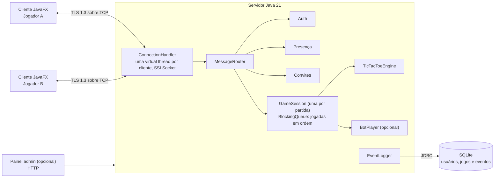

# Arquitetura

Todos os clientes se conectam ao servidor por TLS. Não há comunicação direta cliente-cliente, porque o servidor precisa validar cada jogada. Dentro do servidor, cada partida tem sua própria fila de eventos, processada em ordem por um único consumidor, o que elimina condições de corrida no tabuleiro.

## Diagrama

## Componentes

| Componente | Responsabilidade |
| --- | --- |
| `ConnectionHandler` (uma virtual thread por cliente) | Lê e escreve mensagens enquadradas sobre `SSLSocket`, detecta desconexão (heartbeat) |
| `AuthService` | Cadastro, login, hash PBKDF2, emissão de token de sessão |
| `PresenceService` | Lista de usuários online, broadcast quando alguém entra ou sai |
| `LobbyService` | Convites: criar, aceitar, recusar, expirar |
| `MessageRouter` | Encaminha cada mensagem ao serviço certo ou à fila da partida |
| `GameSession` + `BlockingQueue` | Turnos, validação de jogada, vitória/empate, desistência, reconexão |
| `TicTacToeEngine` (módulo `common`) | Regras puras do jogo, sem rede, testável isolado |
| `BotPlayer` (opcional) | Jogador virtual com minimax |
| `EventLogger` | Registra eventos do servidor em arquivo e no banco |
| `AdminDashboard` (opcional) | Endpoint web com status em tempo real |
| Cliente JavaFX | Telas de login, lobby, partida e placar |

## Fluxo de uma jogada

1. Cliente envia `MOVE {gameId, cell}`, com `cell` de 0 a 8.
2. `MessageRouter` coloca o evento na fila da partida.
3. `GameSession` confere se é a vez do jogador e se a casa está livre.
4. `TicTacToeEngine` aplica a jogada e verifica as 8 linhas de vitória e o empate.
5. O servidor envia `GAME_STATE` aos dois jogadores, ou `GAME_OVER` com o resultado.
6. `EventLogger` registra a jogada e, se for o caso, o fim da partida.

## IPC

- Entre processos (cliente e servidor): sockets TCP com TLS, mensagens enquadradas em JSON. Ver [05-protocolo.md](05-protocolo.md).
- Dentro do servidor: filas `BlockingQueue` entre as threads de conexão e o consumidor de cada partida.
