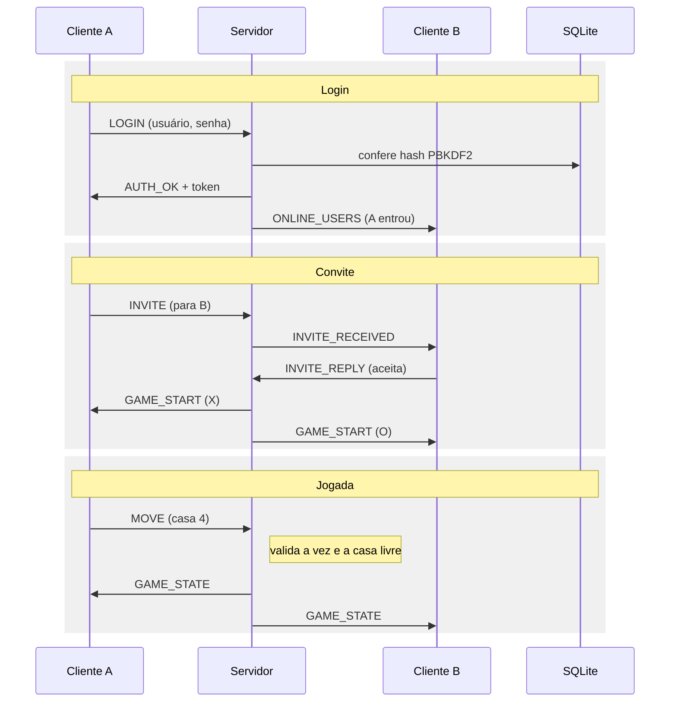
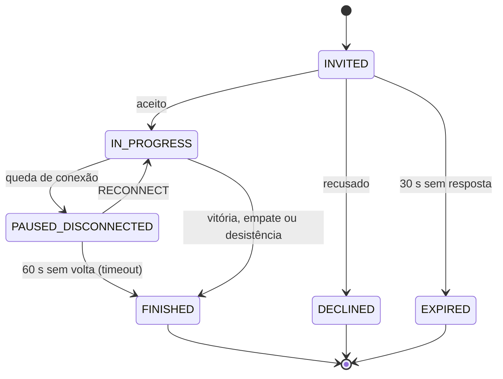

# Protocolo de mensagens

Cada mensagem é um quadro com 4 bytes de tamanho (big-endian, `writeInt`) seguidos de um JSON com envelope fixo. O campo `seq` permite casar respostas com pedidos e reenviar estado após reconexão. Quadros maiores que 64 KB são rejeitados.

```
+----------------+-------------------------------+
| tamanho (4 B)  | JSON UTF-8 (tamanho bytes)    |
+----------------+-------------------------------+
```

```json
{ "type": "MOVE", "seq": 42, "token": "<sessão>", "payload": { "gameId": "g-17", "cell": 4 } }
```

## Mensagens

| Direção | Tipo | Payload principal | Requisito |
| --- | --- | --- | --- |
| C → S | `REGISTER` | username, password | 1 |
| C → S | `LOGIN` | username, password | 2 |
| S → C | `AUTH_OK` / `AUTH_FAIL` | token, motivo | 2 |
| S → C | `ONLINE_USERS` | lista de usuários | 3 |
| C → S | `INVITE` | targetUser (ou `BOT`) | 4 |
| S → C | `INVITE_RECEIVED` | inviteId, from | 4 |
| C → S | `INVITE_REPLY` | inviteId, accept | 5 |
| S → C | `GAME_START` | gameId, oponente, símbolo (X ou O), quem começa | 5 |
| C → S | `MOVE` | gameId, cell (0 a 8) | 6 |
| S → C | `GAME_STATE` | tabuleiro (9 posições), vez, última jogada | 6 |
| S → C | `GAME_OVER` | WIN / LOSS / DRAW, motivo, linha vencedora | 7 |
| C → S | `RESIGN` | gameId | 8 |
| C → S | `RECONNECT` | token, gameId | Reconexão |
| C → S | `LEADERBOARD` | (vazio) | Placar |
| Ambos | `PING` / `PONG` | timestamp | Reconexão |
| S → C | `ERROR` | código, mensagem | 9 |

## Diagrama de sequência: login, convite e jogada

Toda mensagem passa pelo servidor, que valida antes de repassar.



## Diagrama de estados da partida

Desconexão pausa a partida, não encerra.


