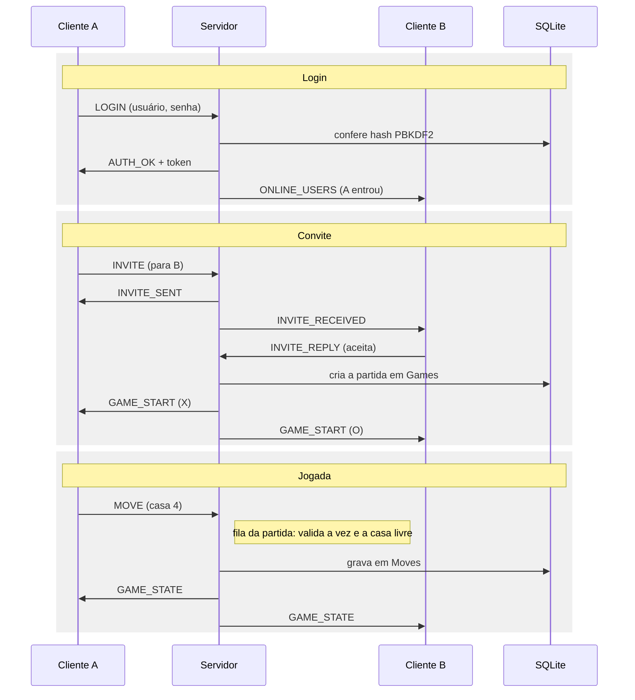
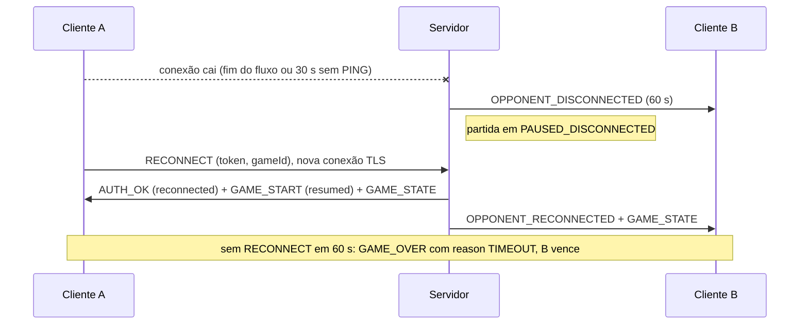
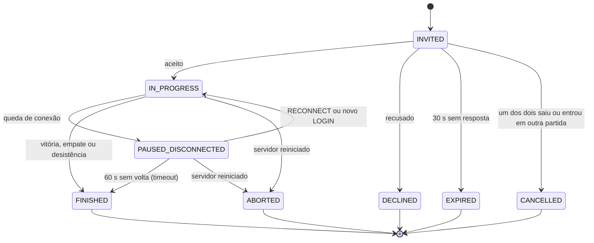

# Protocolo de mensagens

Cada mensagem é um quadro com 4 bytes de tamanho (big-endian, `writeInt`) seguidos de um JSON com envelope fixo. O campo `seq` permite casar respostas com pedidos: o servidor responde com o mesmo `seq` do pedido e usa `0` nas mensagens que ele mesmo inicia. Quadros maiores que 64 KB são rejeitados e a conexão é encerrada.

```
+----------------+-------------------------------+
| tamanho (4 B)  | JSON UTF-8 (tamanho bytes)    |
+----------------+-------------------------------+
```

```json
{ "type": "MOVE", "seq": 42, "token": "<sessão>", "payload": { "gameId": "g-17", "cell": 4 } }
```

Implementação: `FrameCodec`, `Message` e `MessageType` no módulo `common`.

## Mensagens

| Direção | Tipo | Payload principal | Requisito |
| --- | --- | --- | --- |
| C → S | `REGISTER` | username, password | 1 |
| S → C | `REGISTER_OK` | username | 1 |
| C → S | `LOGIN` | username, password | 2 |
| S → C | `AUTH_OK` / `AUTH_FAIL` | token, username, reconnected / reason, blocked | 2 |
| C → S | `LOGOUT` | (vazio); no meio da partida conta como desistência | 2, 8 |
| S → C | `ONLINE_USERS` | users: [{username, inGame}] | 3 |
| C → S | `INVITE` | targetUser | 4 |
| S → C | `INVITE_SENT` | inviteId, to, expiresInSeconds | 4 |
| S → C | `INVITE_RECEIVED` | inviteId, from, expiresInSeconds | 4 |
| C → S | `INVITE_REPLY` | inviteId, accept | 5 |
| S → C | `INVITE_RESULT` | inviteId, from, to, status (DECLINED / EXPIRED / CANCELLED) | 5 |
| S → C | `GAME_START` | gameId, opponent, symbol (X ou O), firstTurn, resumed | 5 |
| C → S | `MOVE` | gameId, cell (0 a 8) | 6 |
| S → C | `GAME_STATE` | gameId, board (9 posições), turn, lastMove, moveCount, status | 6 |
| S → C | `GAME_OVER` | gameId, result (WIN / LOSS / DRAW), reason, winner, board, winningLine | 7 |
| C → S | `RESIGN` | gameId | 8 |
| C → S | `RECONNECT` | token (no envelope), gameId | Reconexão |
| S → C | `OPPONENT_DISCONNECTED` / `OPPONENT_RECONNECTED` | gameId, username, timeoutSeconds | Reconexão |
| C → S | `LEADERBOARD` | (vazio) | Placar |
| S → C | `LEADERBOARD_DATA` | rows: [{username, wins, draws, losses, games}] | Placar |
| Ambos | `PING` / `PONG` | ts | Reconexão |
| S → C | `ERROR` | code, message | 9 |

`REGISTER`, `LOGIN`, `RECONNECT` e `PING` não exigem token. Todas as outras mensagens do cliente precisam do token recebido em `AUTH_OK`, senão o servidor responde `ERROR NOT_AUTHENTICATED`.

`AUTH_FAIL` tem sempre o mesmo texto para usuário inexistente e senha errada (`"Usuário ou senha inválidos"`), e `blocked: true` quando o limite de tentativas foi atingido.

### Códigos de erro

| Código | Quando |
| --- | --- |
| `MALFORMED` | JSON inválido ou sem `type`; a conexão continua |
| `FRAME_TOO_LARGE` | Quadro acima de 64 KB; a conexão é encerrada |
| `UNKNOWN_TYPE` | Tipo de mensagem desconhecido |
| `BAD_REQUEST` | Campo do payload ausente ou com tipo errado |
| `NOT_AUTHENTICATED` | Pedido sem login ou com token errado |
| `RATE_LIMITED` | Mais de 20 mensagens por segundo; acima de 60 a conexão é encerrada |
| `USER_OFFLINE` / `USER_BUSY` | Convite para quem não está online ou já está em partida |
| `INVALID_INVITE` | Convite inexistente, expirado ou duplicado |
| `GAME_NOT_FOUND` | Jogada ou desistência sem partida ativa |
| `NOT_YOUR_TURN` / `INVALID_MOVE` | Jogada fora da vez, em casa ocupada ou fora de 0 a 8 |
| `GAME_PAUSED` | Jogada enquanto o oponente está desconectado |
| `RECONNECT_FAILED` | Token de reconexão inválido ou expirado |
| `SESSION_REPLACED` | O mesmo usuário entrou por outra conexão |

### Exemplos reais

Mensagens recebidas pelos clientes numa sessão real (servidor `velha-server.jar` sobre TLS; o token foi encurtado). A última linha veio de outra sessão, com o cliente de console.

```json
{"type":"REGISTER_OK","seq":1,"payload":{"username":"ana"}}
{"type":"AUTH_OK","seq":2,"payload":{"token":"X4u_dYrZ…","username":"ana","reconnected":false}}
{"type":"ONLINE_USERS","seq":0,"payload":{"users":[{"username":"ana","inGame":false},{"username":"bia","inGame":false}]}}
{"type":"INVITE_SENT","seq":3,"payload":{"inviteId":"i-1","to":"bia","expiresInSeconds":30}}
{"type":"INVITE_RECEIVED","seq":0,"payload":{"inviteId":"i-1","from":"ana","expiresInSeconds":30}}
{"type":"GAME_START","seq":0,"payload":{"gameId":"g-1","opponent":"bia","symbol":"X","firstTurn":"X","resumed":false}}
{"type":"GAME_STATE","seq":0,"payload":{"gameId":"g-1","turn":"O","lastMove":0,"moveCount":1,"status":"IN_PROGRESS","board":["X","","","","","","","",""]}}
{"type":"ERROR","seq":5,"payload":{"code":"NOT_YOUR_TURN","message":"Não é a sua vez"}}
{"type":"GAME_OVER","seq":0,"payload":{"gameId":"g-1","result":"WIN","reason":"THREE_IN_ROW","winner":"ana","board":["X","X","X","O","O","","","",""],"winningLine":[0,1,2]}}
{"type":"GAME_OVER","seq":0,"payload":{"gameId":"g-1","result":"LOSS","reason":"THREE_IN_ROW","winner":"ana","board":["X","X","X","O","O","","","",""],"winningLine":[0,1,2]}}
{"type":"LEADERBOARD_DATA","seq":8,"payload":{"rows":[{"username":"ana","wins":1,"draws":0,"losses":0,"games":1},{"username":"bia","wins":0,"draws":0,"losses":1,"games":1}]}}
{"type":"OPPONENT_DISCONNECTED","seq":0,"payload":{"gameId":"g-1","username":"ana","timeoutSeconds":60}}
```

## Diagrama de sequência: login, convite e jogada

Toda mensagem passa pelo servidor, que valida antes de repassar.



## Diagrama de sequência: queda e reconexão



## Diagrama de estados da partida

Desconexão pausa a partida, não encerra.


