# Relatório Final — Jogo da Velha em Rede

**Disciplina:** Redes de Computadores: Aplicação e Transporte — Unisinos, 2026/2
**Professor:** Silvio Cesar Viegas
**Aluno:** [SEU NOME COMPLETO] (projeto individual)
**Repositório:** [LINK DO GITHUB]
**Data:** [DATA DA ENTREGA]

> **Como ler os marcadores deste rascunho.** Cada `📷 FIGURA` indica um print que ainda falta, com o nome exato do arquivo em `docs/evidencias/`. Quando o arquivo existir, a imagem aparece sozinha; depois apague esta nota e as linhas `📷`.

---

## 1. Visão geral e escolha do jogo

O projeto é um **Jogo da Velha online para 2 jogadores**. Um servidor Java 21 aceita conexões TCP protegidas por TLS 1.3, troca mensagens JSON enquadradas e guarda usuários, partidas e eventos em SQLite. Os clientes são uma aplicação JavaFX (e um cliente de console para depuração).

**Por que o Jogo da Velha.** Está entre os jogos sugeridos e tem regras mínimas (tabuleiro 3x3, 8 linhas de vitória). Assim, quase todo o esforço vai para o que a disciplina avalia: sockets, protocolo, segurança, eventos e robustez.

**Regras.**

1. Tabuleiro 3x3, casas numeradas de 0 a 8 (esquerda para a direita, de cima para baixo).
2. Dois jogadores, X e O; X começa (quem convidou é X).
3. Cada jogador marca uma casa livre na sua vez.
4. Vence quem completar uma linha, coluna ou diagonal; tabuleiro cheio sem vencedor é empate.
5. Um jogador pode desistir a qualquer momento, e o oponente vence.

**Princípio central:** o servidor é a única fonte da verdade. O cliente só envia intenções ("marcar a casa 4"); o servidor valida e devolve o estado oficial aos dois jogadores.

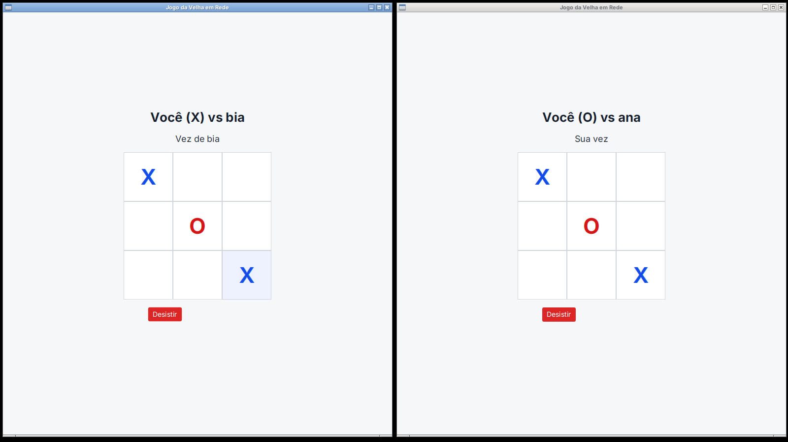
> 📷 **FIGURA 1** — `11_partida_andamento.png`: os dois clientes lado a lado no meio de uma partida.

---

## 2. Requisitos

### 2.1 Requisitos base

| # | Requisito | Como é atendido | Status | Evidência |
| --- | --- | --- | --- | --- |
| 1 | Cadastro com persistência segura | `REGISTER`; senha com PBKDF2 em `Users` | Feito | Fig. 5; teste `passwordIsNotStoredInPlainText` |
| 2 | Autenticação sem expor dados | `LOGIN` sobre TLS; token de sessão; falha genérica | Feito | Fig. 2, 3, 8 |
| 3 | Usuários online | `ONLINE_USERS` a cada entrada e saída | Feito | Fig. 9 |
| 4 | Criar jogo e convidar | `INVITE` → `INVITE_RECEIVED` | Feito | Fig. 10 |
| 5 | Aceitar ou recusar convite | `INVITE_REPLY`; expira em 30 s | Feito | Fig. 10 |
| 6 | Jogar na sua vez, tabuleiro sincronizado | Fila por partida; `GAME_STATE` para os dois | Feito | Fig. 1, 14 |
| 7 | Resultado final para ambos | `GAME_OVER` com WIN / LOSS / DRAW e a linha vencedora | Feito | Fig. 11, 12 |
| 8 | Sair e conceder vitória | `RESIGN` (e `LOGOUT` no meio da partida) | Feito | Fig. 13 |
| 9 | Monitorar eventos do servidor | `logs/server.log` + tabela `ServerEvents` | Feito | Fig. 7, 20, 21 |
| 10 | Sem limite de usuários e partidas | Virtual thread por conexão; uma `GameSession` por partida | Feito | Fig. 17 (50 clientes, 25 partidas) |

### 2.2 Opcionais

O guia recomenda escolher 1 ou 2 opcionais e fazê-los bem. Foram escolhidos:

| Opcional | Como | Status |
| --- | --- | --- |
| Reconexão | Heartbeat (`PING` a cada 10 s), partida pausa por 60 s, `RECONNECT` devolve o tabuleiro | Feito (Fig. 15) |
| Placar | Consulta de vitórias, empates e derrotas sobre a tabela `Games` | Feito (Fig. 16) |
| Bot, painel admin, nuvem | — | Não feitos, por decisão de escopo |

### 2.3 Requisitos não funcionais

- Todo o tráfego cifrado com TLS 1.3.
- Senhas nunca armazenadas em texto.
- O servidor não cai por mensagem malformada, quadro gigante, flood ou cliente desconectado.
- O estado do jogo é consistente para os dois jogadores em todos os casos (fila única por partida).

---

## 3. Arquitetura

Todos os clientes se conectam ao servidor; não há comunicação cliente-cliente, porque o servidor precisa validar cada jogada.

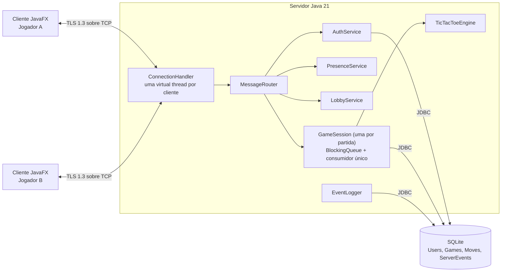

| Componente | Papel |
| --- | --- |
| `ConnectionHandler` | Handshake TLS, leitura e escrita de quadros, limite de mensagens por segundo, detecção de queda (timeout de 30 s) |
| `MessageRouter` | Exige login e confere o token; entrega cada mensagem ao serviço certo ou à fila da partida |
| `AuthService` | Cadastro, login com PBKDF2, limite de tentativas, tokens de sessão |
| `PresenceService` | Lista de online e broadcast de `ONLINE_USERS` |
| `LobbyService` | Convites: criar, aceitar, recusar, expirar, cancelar |
| `GameSession` | Turnos, validação, vitória/empate, desistência, pausa e reconexão |
| `TicTacToeEngine` | Regras puras, sem rede (módulo `common`, testado isolado) |
| `EventLogger` | Eventos em `logs/server.log` e na tabela `ServerEvents` |
| Cliente JavaFX | Telas de login, lobby (online, convites, placar) e partida |

O código está em três módulos Maven: `common` (protocolo e regras, compartilhados), `server` e `client`.

### 3.1 Fluxo de rede

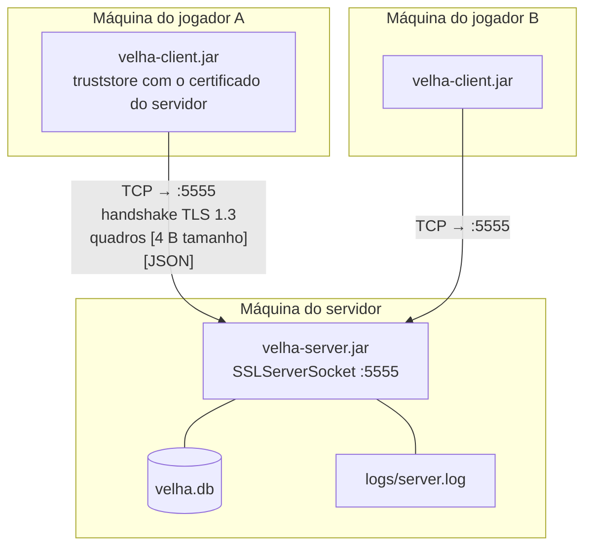

Cada cliente abre **uma** conexão TCP persistente para a porta 5555. Sobre ela acontece o handshake TLS 1.3 e, depois, a troca de quadros nos dois sentidos durante toda a sessão. O servidor envia mensagens a qualquer momento (convites, jogadas do oponente), por isso a conexão fica aberta em vez de seguir o modelo pedido-resposta.

### 3.2 IPC (comunicação entre processos e entre threads)

| Nível | Mecanismo | Por quê |
| --- | --- | --- |
| Entre processos (cliente ↔ servidor) | Sockets TCP com TLS (`SSLSocket`), quadros `[tamanho][JSON]` | TCP garante entrega e ordem; o enquadramento resolve o fato de TCP ser um fluxo de bytes sem fronteiras de mensagem |
| Dentro do servidor (threads de conexão → partida) | `BlockingQueue` por partida, com um único consumidor | Event bus: as ações de dois jogadores, quedas e timeouts chegam por threads diferentes e são processadas em ordem, sem condição de corrida no tabuleiro |
| Dentro do servidor (agendamentos) | `ScheduledExecutorService` | Expiração de convite (30 s) e de reconexão (60 s) entram na mesma fila como eventos |
| Dentro do cliente | Thread de leitura → `Platform.runLater` | A rede nunca bloqueia a interface; a tela só é alterada na thread do JavaFX |

### 3.3 Fluxo de uma jogada

1. O cliente envia `MOVE {gameId, cell}`.
2. O `MessageRouter` confere o token e coloca o evento na fila da partida.
3. A `GameSession` confere se é a vez do jogador e se a partida não está pausada.
4. O `TicTacToeEngine` aplica a jogada e verifica as 8 linhas e o empate.
5. A jogada é gravada em `Moves`; o servidor envia `GAME_STATE` aos dois e, se acabou, `GAME_OVER`.
6. O `EventLogger` registra a jogada e o fim da partida.

---

## 4. Protocolo e payloads

Cada mensagem é um quadro com 4 bytes de tamanho (big-endian) seguidos de um JSON UTF-8 com envelope fixo. Quadros acima de 64 KB são rejeitados.

```
+----------------+-------------------------------+
| tamanho (4 B)  | JSON UTF-8 (tamanho bytes)    |
+----------------+-------------------------------+
```

```json
{ "type": "MOVE", "seq": 42, "token": "<sessão>", "payload": { "gameId": "g-17", "cell": 4 } }
```

O campo `seq` casa respostas com pedidos (o servidor responde com o mesmo `seq`; usa 0 nas mensagens que ele inicia). O `token` é exigido em toda mensagem depois do login.

### 4.1 Mensagens

| Direção | Tipo | Payload | Req. |
| --- | --- | --- | --- |
| C → S | `REGISTER` / `LOGIN` | username, password | 1, 2 |
| S → C | `REGISTER_OK` / `AUTH_OK` / `AUTH_FAIL` | username / token, reconnected / reason, blocked | 1, 2 |
| C → S | `LOGOUT` | — | 2, 8 |
| S → C | `ONLINE_USERS` | users: [{username, inGame}] | 3 |
| C → S | `INVITE` | targetUser | 4 |
| S → C | `INVITE_SENT` / `INVITE_RECEIVED` | inviteId, to/from, expiresInSeconds | 4 |
| C → S | `INVITE_REPLY` | inviteId, accept | 5 |
| S → C | `INVITE_RESULT` | inviteId, status (DECLINED / EXPIRED / CANCELLED) | 5 |
| S → C | `GAME_START` | gameId, opponent, symbol, firstTurn, resumed | 5 |
| C → S | `MOVE` | gameId, cell | 6 |
| S → C | `GAME_STATE` | board[9], turn, lastMove, moveCount, status | 6 |
| S → C | `GAME_OVER` | result, reason, winner, board, winningLine | 7 |
| C → S | `RESIGN` | gameId | 8 |
| C → S | `RECONNECT` | token, gameId | Reconexão |
| S → C | `OPPONENT_DISCONNECTED` / `OPPONENT_RECONNECTED` | gameId, username, timeoutSeconds | Reconexão |
| C → S / S → C | `LEADERBOARD` / `LEADERBOARD_DATA` | rows: [{username, wins, draws, losses, games}] | Placar |
| Ambos | `PING` / `PONG` | ts | Reconexão |
| S → C | `ERROR` | code, message | 9 |

Códigos de erro: `MALFORMED`, `FRAME_TOO_LARGE`, `UNKNOWN_TYPE`, `BAD_REQUEST`, `NOT_AUTHENTICATED`, `RATE_LIMITED`, `USER_OFFLINE`, `USER_BUSY`, `INVALID_INVITE`, `GAME_NOT_FOUND`, `NOT_YOUR_TURN`, `INVALID_MOVE`, `GAME_PAUSED`, `RECONNECT_FAILED`, `SESSION_REPLACED`.

### 4.2 Exemplos reais de payload

Mensagens recebidas pelos clientes numa sessão real (token encurtado):

```json
{"type":"AUTH_OK","seq":2,"payload":{"token":"X4u_dYrZ…","username":"ana","reconnected":false}}
{"type":"ONLINE_USERS","seq":0,"payload":{"users":[{"username":"ana","inGame":false},{"username":"bia","inGame":false}]}}
{"type":"INVITE_RECEIVED","seq":0,"payload":{"inviteId":"i-1","from":"ana","expiresInSeconds":30}}
{"type":"GAME_START","seq":0,"payload":{"gameId":"g-1","opponent":"bia","symbol":"X","firstTurn":"X","resumed":false}}
{"type":"GAME_STATE","seq":0,"payload":{"gameId":"g-1","turn":"O","lastMove":0,"moveCount":1,"status":"IN_PROGRESS","board":["X","","","","","","","",""]}}
{"type":"ERROR","seq":5,"payload":{"code":"NOT_YOUR_TURN","message":"Não é a sua vez"}}
{"type":"GAME_OVER","seq":0,"payload":{"gameId":"g-1","result":"WIN","reason":"THREE_IN_ROW","winner":"ana","board":["X","X","X","O","O","","","",""],"winningLine":[0,1,2]}}
```

E o pedido de login como aparece na rede **sem** TLS, extraído de `01_sessao_sem_tls.pcapng`:

```json
{"type":"LOGIN","seq":2,"payload":{"username":"ana","password":"senha123"}}
```

### 4.3 Diagrama de sequência: login, convite e jogada

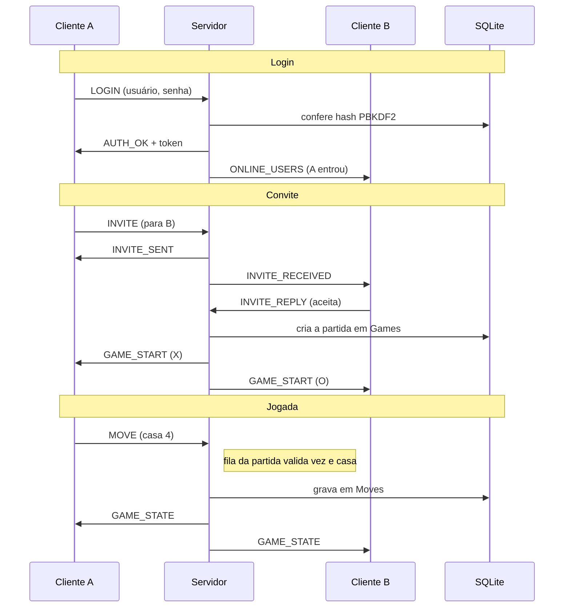

### 4.4 Diagrama de sequência: queda e reconexão

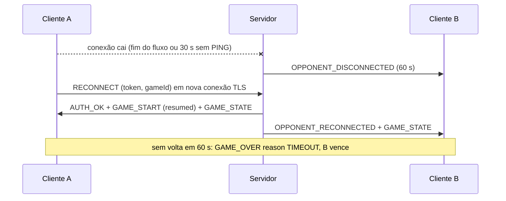

### 4.5 Diagrama de estados da partida

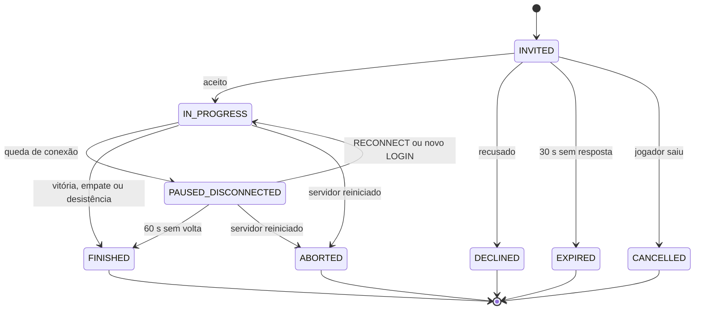

---

## 5. Segurança

A defesa principal é TLS em todo o tráfego mais um servidor que nunca confia no cliente.

| Ameaça | Mitigação | Evidência |
| --- | --- | --- |
| Senha vazada do banco | `PBKDF2WithHmacSHA256`, 210 mil iterações, salt aleatório de 16 bytes por usuário | Fig. 5 |
| Sniffing na rede | TLS 1.3 (JSSE) em todas as conexões | Fig. 2, 3; capturas `.pcapng` |
| Man in the Middle | O cliente confia **só** no certificado do servidor (truststore próprio) | Fig. 4; teste `clientRejectsServerWithUntrustedCertificate` |
| Jogada trapaceada | O servidor valida vez, casa livre e estado; o cliente só envia intenção | Fig. 14; teste `moveOutOfTurnOrOnOccupiedCellIsRejected` |
| Sequestro de sessão | Token aleatório de 32 bytes por login, exigido em todo pedido, invalidado no logout | Testes `requestsNeedValidToken`, `logoutInvalidatesToken` |
| Força bruta no login | No máximo 5 tentativas por minuto por usuário e IP | Fig. 18 |
| Flood / DoS simples | Quadro máximo de 64 KB, 20 mensagens/s por conexão, timeouts de handshake (10 s) e de inatividade (30 s) | Testes `oversizedFrameClosesOnlyThatConnection`, `floodIsRateLimited` |
| Enumeração de usuários | Mesma resposta (e mesmo custo de hash) para usuário inexistente e senha errada | Teste `registerLoginDuplicateAndWrongPassword` |

**Observação sobre o enunciado:** ele cita "SHA-64", que não existe. O projeto usa SHA-256 dentro do PBKDF2, que além de hash tem salt e custo alto, o que torna ataques de dicionário caros.

**Armazenar com segurança e não expor são requisitos diferentes:** o hash protege a senha no banco (requisito 1); o TLS protege a senha no caminho (requisito 2).

### 5.1 Antes e depois do TLS

A mesma sessão (2 cadastros, 2 logins, convite e partida até a vitória) foi capturada duas vezes na interface de loopback:

| Captura | Senha `senha123` nos bytes | Mensagens JSON legíveis | Protocolo |
| --- | --- | --- | --- |
| `01_sessao_sem_tls.pcapng` (servidor com `--sem-tls`) | 4 vezes | 44 | TCP com JSON em claro |
| `02_sessao_com_tls.pcapng` | 0 vezes | 0 | TLS 1.3 (`supported_version 0x0304`), só `Application Data` |

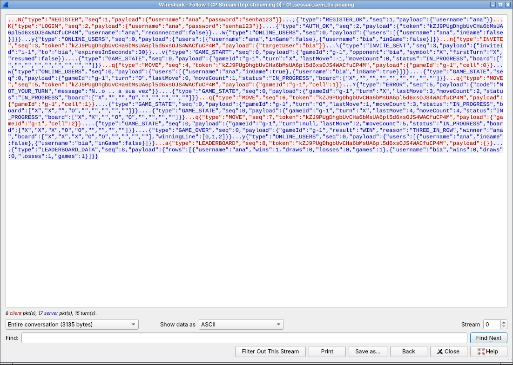
> 📷 **FIGURA 2** — `03_wireshark_sem_tls.png`: "Follow TCP Stream" da captura sem TLS mostrando o `LOGIN` com a senha.

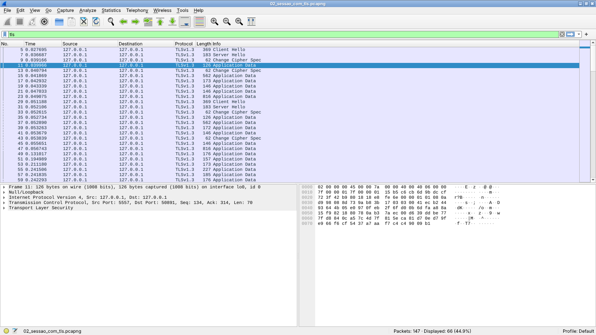
> 📷 **FIGURA 3** — `04_wireshark_com_tls.png`: lista de pacotes da captura com TLS (handshake TLSv1.3 e `Application Data`).

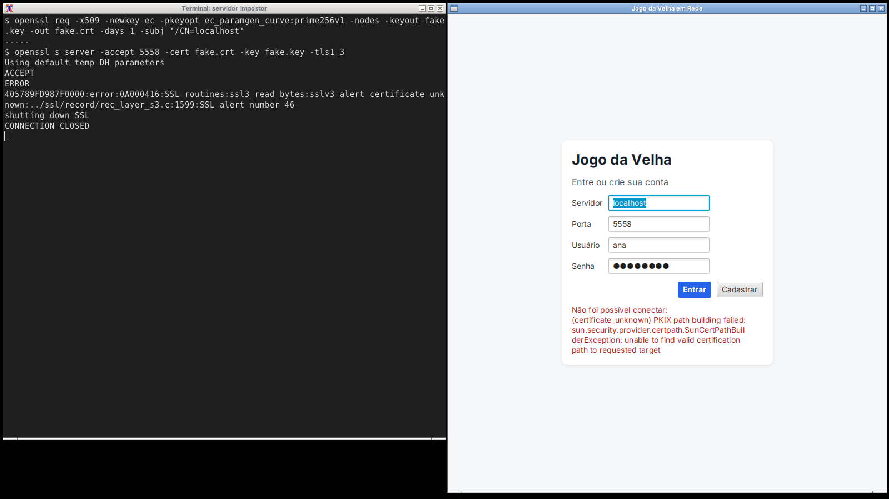
> 📷 **FIGURA 4** — `05_mitm_rejeitado.png`: o cliente recusa um servidor TLS com outro certificado.

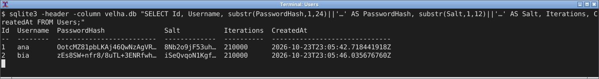
> 📷 **FIGURA 5** — `08_tabela_users_hash.png`: tabela `Users` com hash, salt e iterações.

---

## 6. Testes

O plano foi escrito antes da execução ([10-plano-de-testes.md](10-plano-de-testes.md)). A suíte automatizada tem **65 testes JUnit 5**, todos passando (`./mvnw verify`):

| Módulo | Testes | O que cobre |
| --- | --- | --- |
| `common` | 20 | Regras do jogo (8 linhas de vitória, empate, jogadas inválidas) e enquadramento (limite de 64 KB, JSON malformado) |
| `server` | 41 | Hash de senha, limite de login e **testes de ponta a ponta com clientes reais sobre TLS** |
| `client` | 4 | Opções de linha de comando e truststore |

### 6.1 Casos do plano e resultados

| Caso | Resultado | Teste |
| --- | --- | --- |
| Vitória nas 8 linhas, empate, jogada inválida | Passou | `TicTacToeEngineTest` |
| Hash com salts diferentes, verificação | Passou | `PasswordHasherTest` |
| Cadastro, login, duplicado e senha errada (erro genérico) | Passou | `registerLoginDuplicateAndWrongPassword` |
| Lista de online ao entrar e sair | Passou | `onlineListUpdatesOnJoinAndLeave` |
| Convite aceito, recusado e expirado | Passou | `inviteAccepted…`, `inviteDeclined…`, `inviteExpires` |
| Partida até vitória, derrota e empate | Passou | `fullGameUntilWin`, `oCanWin`, `fullGameUntilDraw` |
| Desistência | Passou | `resignGivesOpponentTheWin`, `logoutDuringGameConcedes` |
| Eventos em arquivo e em `ServerEvents` | Passou | `eventsAreRecordedInDatabase` |
| 50 clientes e 25 partidas simultâneas | Passou | `LoadTest`, `LoadTestMain` |
| App fechado no meio da partida | Passou | `reconnectResumesGame`, `opponentWinsIfDisconnectedPlayerDoesNotReturn` |
| Servidor reiniciado | Passou | `serverRestartAbortsGamesAndClientsAreDisconnected` |
| Mensagem malformada e quadro maior que 64 KB | Passou | `malformedMessageKeepsConnectionAlive`, `oversizedFrameClosesOnlyThatConnection` |
| Jogada fora da vez | Passou | `moveOutOfTurnOrOnOccupiedCellIsRejected` |
| Captura antes e depois do TLS | Passou | Seção 5.1 |
| Certificado falso (MitM) | Passou | `clientRejectsServerWithUntrustedCertificate` |
| 6 logins errados em 1 minuto | Passou | `sixWrongLoginsInAMinuteAreBlocked` |
| Placar | Passou | `leaderboardCountsWinsAndDraws` |
| Partida em 2 máquinas diferentes | [PREENCHER: passou/falhou, data] | Manual, Fig. 19 |


> 📷 **FIGURA 6** — `20_testes_mvn_verify.png`: terminal com o resumo dos 65 testes e `BUILD SUCCESS`.

### 6.2 Evidências da demonstração

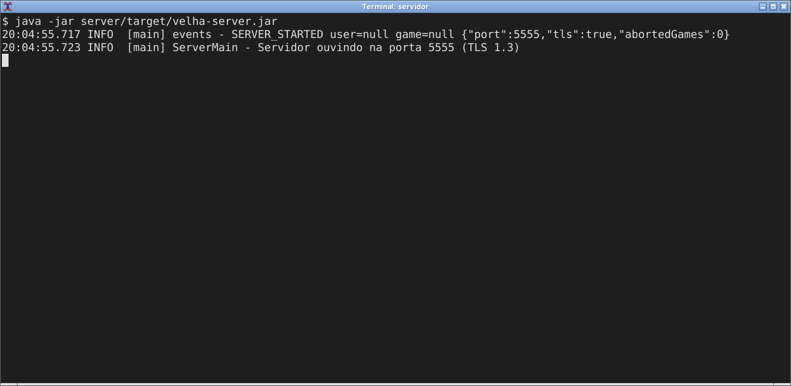
> 📷 **FIGURA 7** — `06_servidor_inicializacao.png`: log de inicialização do servidor (porta, TLS 1.3).

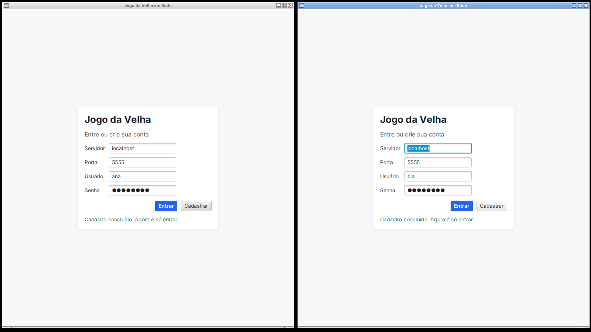
> 📷 **FIGURA 8** — `07_login_dois_clientes.png`: tela de login nos dois clientes.

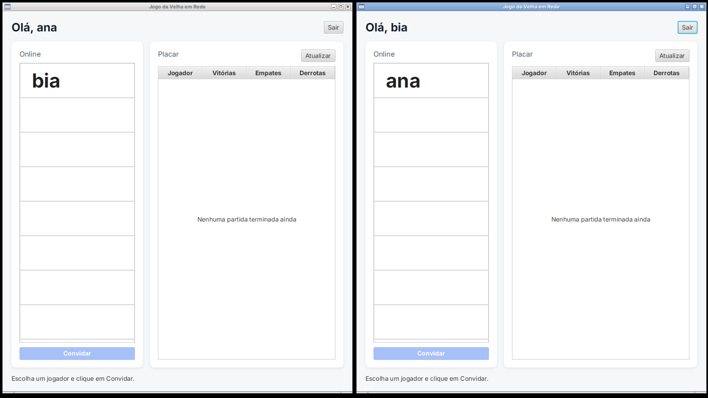
> 📷 **FIGURA 9** — `09_lobby_online.png`: lobby dos dois jogadores, cada um vendo o outro online.

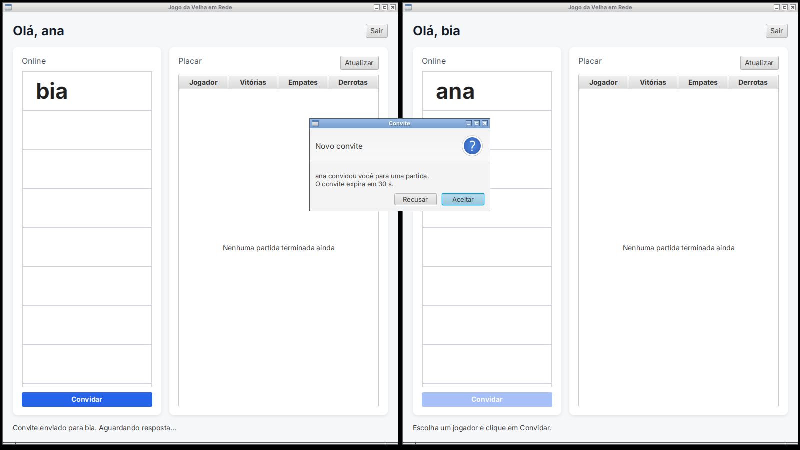
> 📷 **FIGURA 10** — `10_convite_recebido.png`: janela de convite com Aceitar/Recusar.

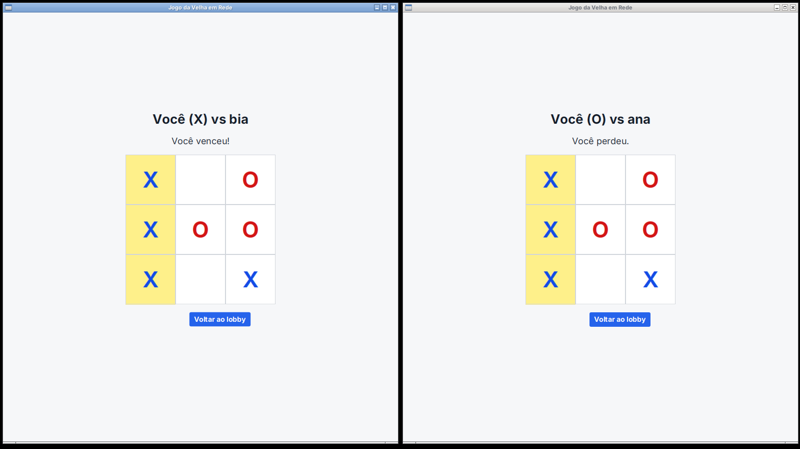
> 📷 **FIGURA 11** — `12_resultado_vitoria.png`: fim de partida, "Você venceu!" de um lado e "Você perdeu." do outro, com a linha destacada.

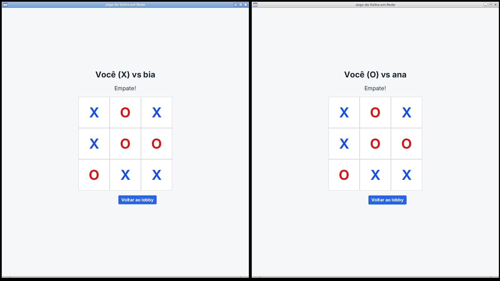
> 📷 **FIGURA 12** — `13_resultado_empate.png`: tabuleiro cheio, "Empate!" nos dois clientes.

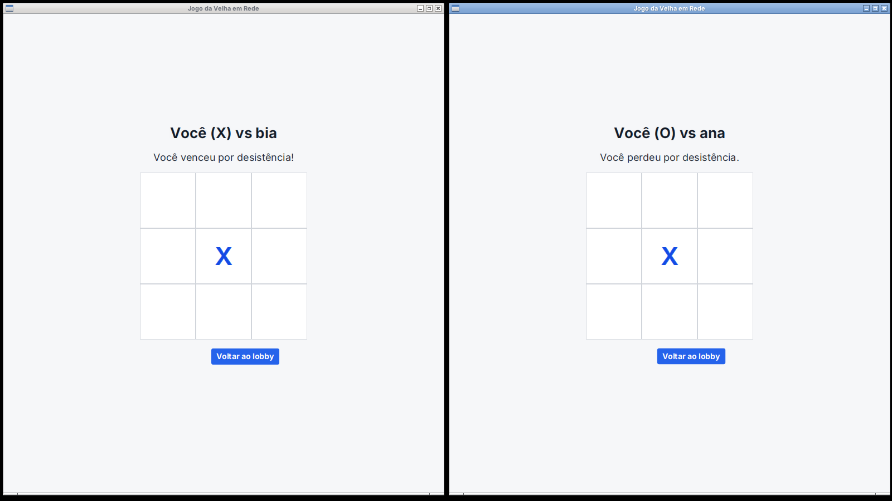
> 📷 **FIGURA 13** — `14_desistencia.png`: segunda partida, um jogador desiste e o outro vence "por desistência".

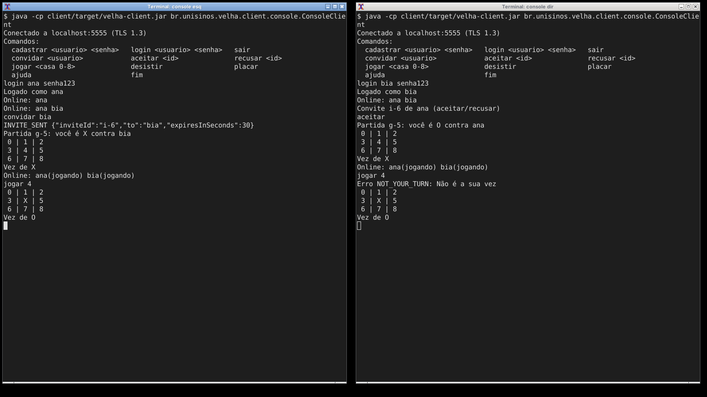
> 📷 **FIGURA 14** — `15_jogada_fora_da_vez.png`: cliente de console recebendo `Erro NOT_YOUR_TURN`.

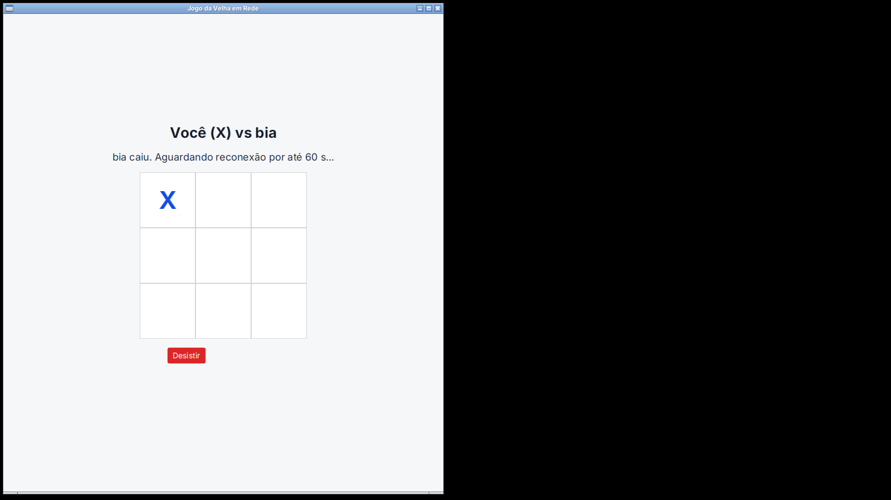
> 📷 **FIGURA 15** — `16_reconexao.png`: "bia caiu. Aguardando reconexão por até 60 s..." no cliente do oponente.

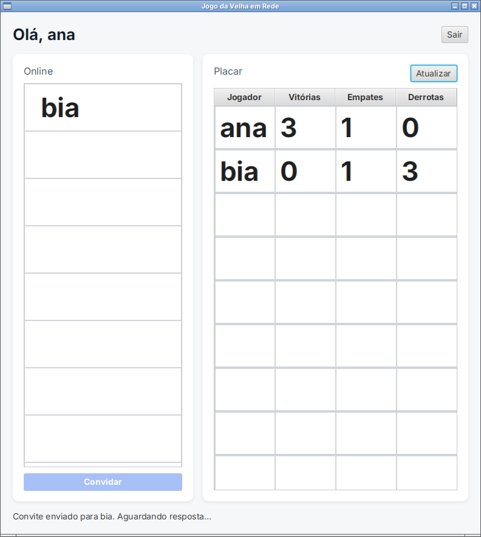
> 📷 **FIGURA 16** — `17_placar.png`: placar no lobby depois das partidas.

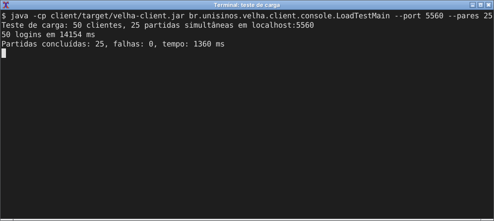
> 📷 **FIGURA 17** — `22_teste_carga.png`: `LoadTestMain` com 50 clientes e 25 partidas concluídas, 0 falhas.

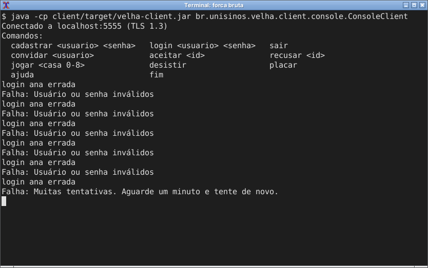
> 📷 **FIGURA 18** — `21_forca_bruta.png`: cliente de console bloqueado após 5 tentativas erradas.


> 📷 **FIGURA 19** — `23_duas_maquinas.png`: foto ou print das duas máquinas jogando (feito manualmente).

---

## 7. Monitoramento

O servidor registra cada evento relevante em dois lugares (requisito 9):

- **Arquivo** `logs/server.log` (Logback, rotação diária, 14 dias), com horário, nível, thread, tipo, usuário, partida e detalhes em JSON.
- **Banco**, na tabela `ServerEvents` (Timestamp, Level, Type, UserId, GameId, Details).

| Nível | Eventos |
| --- | --- |
| INFO | início/fim do servidor, conexão aberta/fechada, cadastro, login, logout, desconexão, reconexão, convites, início de partida, jogada, desistência, retomada, fim de partida |
| WARN | login errado ou bloqueado, cadastro recusado, reconexão recusada, partida pausada, mensagem malformada, tipo desconhecido, quadro gigante, flood, timeout, falha de handshake TLS, erro de rede |
| ERROR | exceções inesperadas (com a mensagem nos detalhes) |

**Depuração:**

- Consultas em `ServerEvents` reconstroem o que aconteceu; `Moves` permite refazer uma partida jogada a jogada.
- Wireshark com o filtro `tcp.port == 5555` mostra o handshake TLS e o tráfego cifrado.
- O JDK não exporta as chaves de sessão TLS, então, para ver o JSON, servidor e clientes aceitam `--sem-tls` (o mesmo modo usado na captura de comparação).
- O cliente de console imprime cada mensagem recebida.

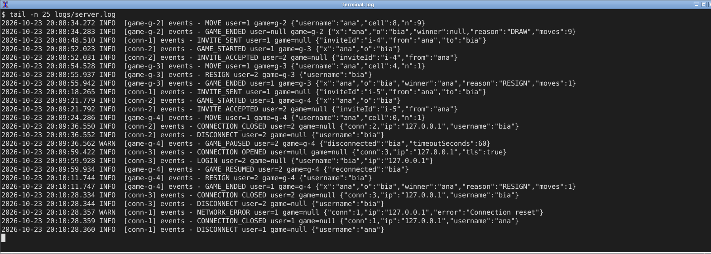
> 📷 **FIGURA 20** — `18_log_servidor.png`: trecho de `logs/server.log` com login, partida e fim.

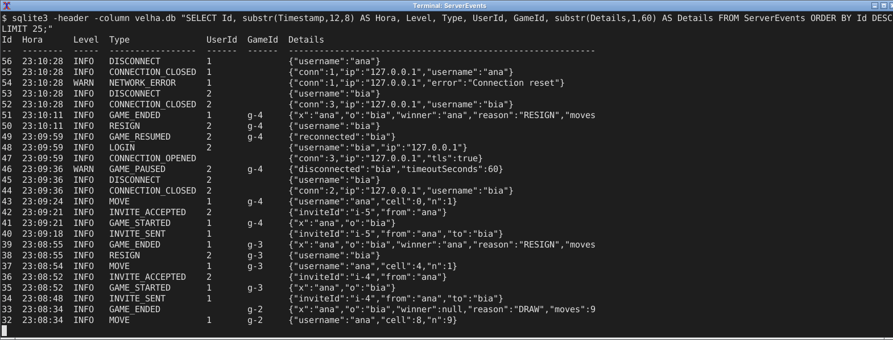
> 📷 **FIGURA 21** — `19_server_events.png`: consulta na tabela `ServerEvents`.

---

## 8. Decisões e justificativas

| Decisão | Por quê |
| --- | --- |
| **Java 21** | Linguagem preferida no guia; virtual threads permitem uma thread por conexão sem limite prático |
| **Sockets TCP puros** em vez de framework web | O guia pede sockets sobre TCP/IP; enquadramento, TLS e ciclo de vida da conexão ficam visíveis no código e no Wireshark |
| **TCP e não UDP** | O jogo precisa de entrega garantida e em ordem; perder ou inverter uma jogada quebraria o estado |
| **Sem MQTT** | Um broker esconderia parte do protocolo e seria mais um componente para instalar e proteger; o roteamento por partida fica no `MessageRouter` com as filas de cada `GameSession` |
| **Enquadramento por tamanho** | TCP é um fluxo de bytes; o prefixo de 4 bytes delimita cada JSON e permite rejeitar quadros grandes antes de alocar memória |
| **JSON (Jackson)** | Legível no Wireshark sem TLS e fácil de depurar |
| **TLS 1.3 com certificado autoassinado** | Confidencialidade e integridade; o cliente fixa o certificado do servidor, então não precisa de autoridade certificadora e ainda barra MitM |
| **PBKDF2** | Nativo no JDK, lento de propósito e com salt |
| **Fila por partida** | Elimina condições de corrida: jogadas, quedas e timeouts são processados em ordem por um único consumidor |
| **SQLite** | Zero instalação, fácil de entregar e demonstrar |
| **Opcionais: reconexão e placar** | O guia pede 1 ou 2 bem feitos; reconexão aprofunda o tema de rede (heartbeat, queda, retomada) e o placar reaproveita o histórico em `Games` |
| **Mensagens acrescentadas ao plano** | `REGISTER_OK`, `INVITE_SENT`, `INVITE_RESULT`, `OPPONENT_DISCONNECTED/RECONNECTED`, `LEADERBOARD_DATA`, `LOGOUT`: todo pedido tem resposta e os dois lados ficam sabendo de recusas, expirações e quedas |
| **Token e reconexão** | O token vale para a conexão em que foi emitido; com partida em andamento, vale também para `RECONNECT` por 60 s após a queda |

### 8.1 Processo

O projeto foi desenvolvido individualmente, com Git: uma branch por funcionalidade, commits no padrão Conventional Commits e merge por squash na `main`. O CI (GitHub Actions) roda `./mvnw verify` a cada push e pull request.

### 8.2 Limitações e próximos passos

- O jar do cliente é específico do sistema operacional em que foi gerado (JavaFX).
- O cliente não verifica o nome do host no certificado (fixa o certificado), para funcionar por IP na demo.
- Partidas em andamento quando o servidor cai são registradas como `ABORTED`, não retomadas.
- Próximos passos: bot com minimax, painel admin web, deploy em nuvem.

### 8.3 Lições aprendidas

[PREENCHER com suas palavras: 3 a 5 itens. Ex.: por que o enquadramento é necessário sobre TCP; o que muda no Wireshark com TLS; como a fila por partida evitou condições de corrida; o que deu trabalho na reconexão.]

---

## Anexo A — Como executar

```bash
./mvnw package -DskipTests
scripts/gerar-certificados.sh                 # ou: scripts/gerar-certificados.sh <IP do servidor>
java -jar server/target/velha-server.jar      # porta 5555
java -jar client/target/velha-client.jar --host <IP do servidor>
./mvnw verify                                 # 65 testes
```

Detalhes no [README](../README.md).
